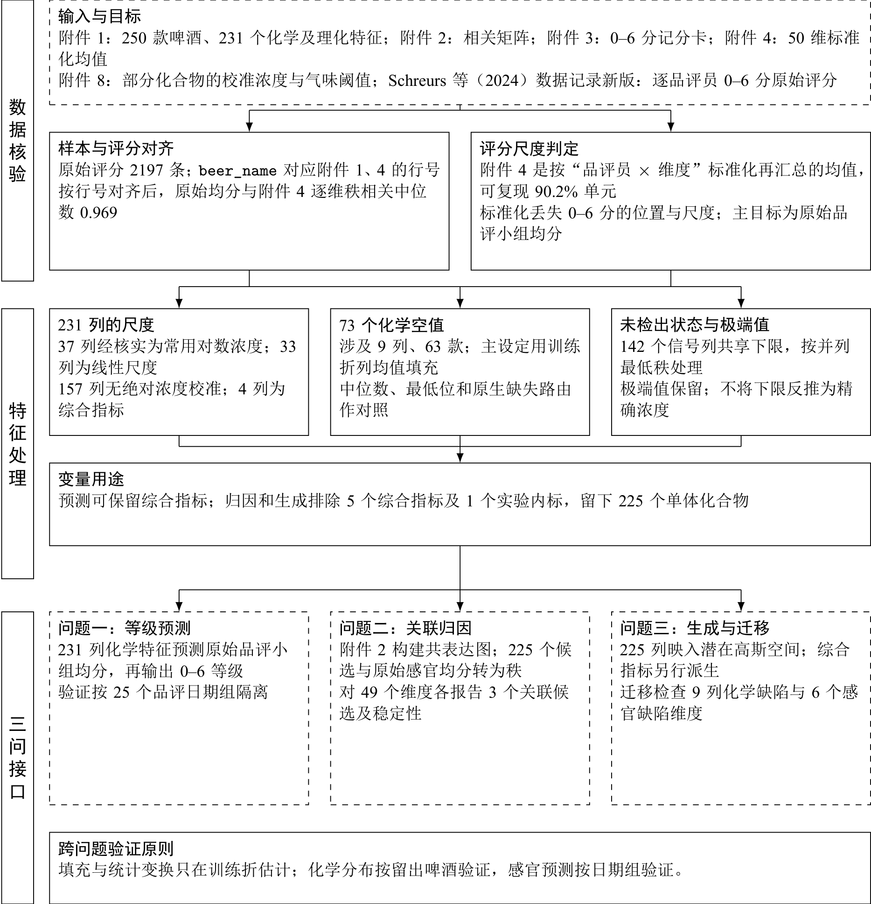
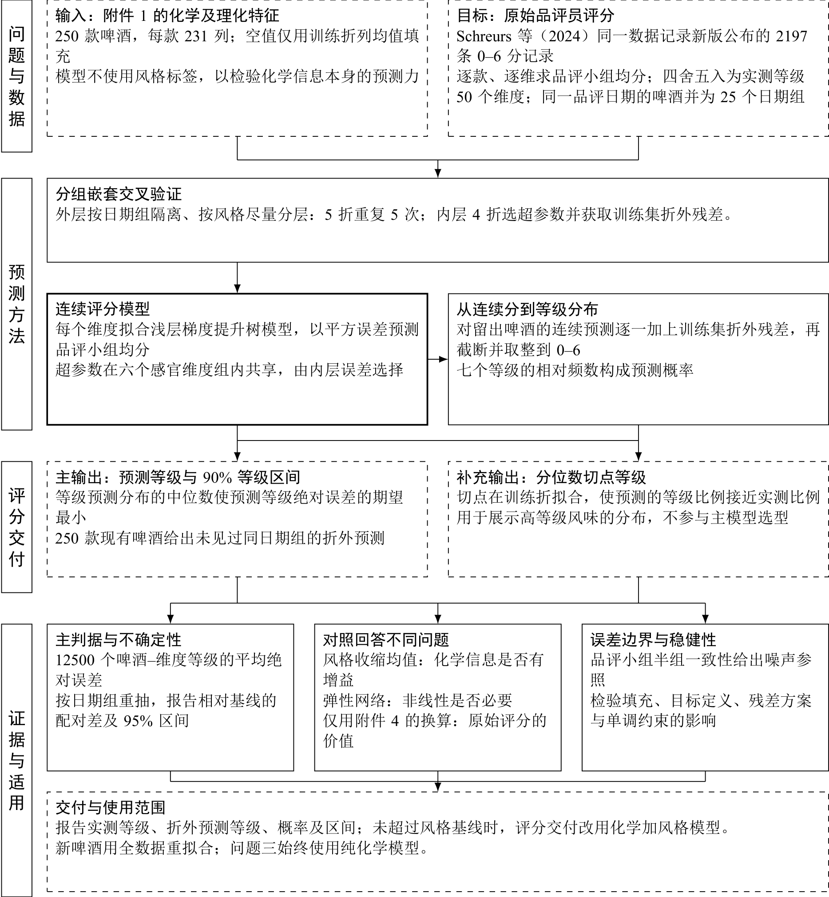
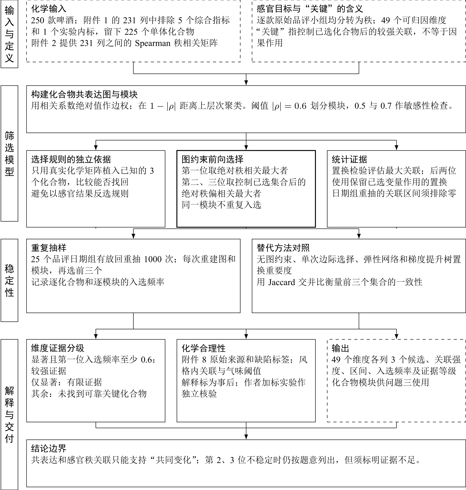
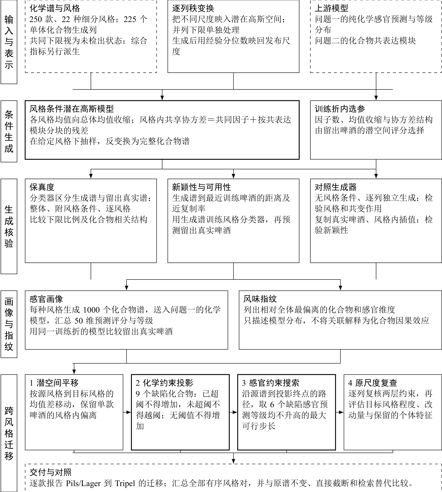

# 方法流程图

数据预处理与三个问题各一张流程图，以 `data_preprocessing.md`、`q1_methodology.md`、`q2_methodology.md`、`q3_methodology.md` 的现行口径为准。图内只写数据核验数字、方法、输出与结论边界，不把预运行效果写作最终结果。方法源文件改变时应同步图源并重新编译。

| 图 | 论文位置 | 图源 | 编译命令 | 图幅（毫米） |
|---|---|---|---|---:|
|  | 数据预处理章末 | `paper/figures/prep_methodology_flowchart.tex` | `python code/scripts/fig_prep_methodology_flowchart.py` | 158 × 164 |
|  | 问题一模型建立节首 | `paper/figures/q1_methodology_flowchart.tex` | `python code/scripts/fig_q1_methodology_flowchart.py` | 158 × 171 |
|  | 问题二模型建立节首 | `paper/figures/q2_methodology_flowchart.tex` | `python code/scripts/fig_q2_methodology_flowchart.py` | 158 × 166 |
|  | 问题三模型建立节首 | `paper/figures/q3_methodology_flowchart.tex` | `python code/scripts/fig_q3_methodology_flowchart.py` | 158 × 176 |

每张图输出单页 PDF、SVG 和 300 dpi PNG 到 `figures/`。论文使用 PDF；插图宽度以正文版心为上限。共用排版样式位于 `paper/figures/flowchart_style.tex`：虚线框表示输入或输出，粗框表示主方法步骤，细框表示依据或对照；箭头给出数据流和处理顺序。

四图的阅读主线如下。

- **数据预处理：** 数据来源与评分对齐 → 尺度、空值及未检出状态 → 变量用途 → 三问各自的输入和验证单位。未校准信号的对数底数在图内保持为假设。
- **问题一：** 化学特征与原始评分 → 日期组嵌套交叉验证 → 连续评分与等级预测分布 → 主输出及补充输出 → 预测误差、对照和不确定性 → 折外评分及全数据模型。
- **问题二：** 化合物与感官秩 → 共表达图 → 模拟还原支持的图约束前向选择及置换检验 → 日期组重抽和替代方法 → 化学证据与前三项关联候选。图内明确“关键”是关联定义，不是因果主张。
- **问题三：** 风格和化学谱 → 秩变换与风格条件潜在高斯模型 → 留出啤酒的保真、新颖性、可用性检查 → 感官画像与风味指纹 → 潜空间平移、化学投影、感官路径及原尺度复查。

图采用完整中文名称解释统计量与对照的作用，不使用需查正文才能识别的内部代号。完整参数网格、数值验收阈值及敏感性臂仍以各问题的方法源文件为准。
