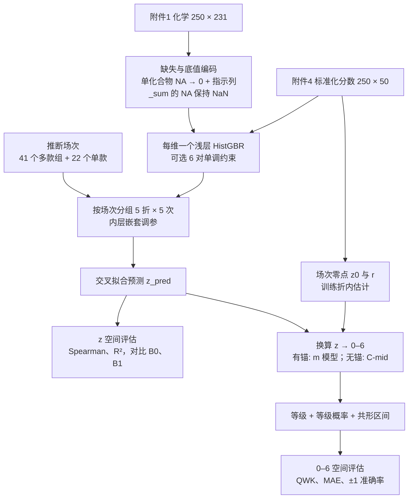

# 问题 1 方法论：数据缺失条件下的感官评分

**这是什么**：问题 1 的方法论文档，回答"用什么方法、为什么、在什么情况下会被推翻"。它不是最终结果：不训练最终模型、不调参。6 段检查代码只做"会改变决策"的最小检查，合计运行约 5 秒。代码另存为 `src/q1_methodology_checks.py`，运行输出原样附在第 3 节各检查之后。

**边界**：只处理问题 1，问题 2、3 只在第 11 节说明接口；不用外部建模数据；只读 `data/raw` 与 `results/data_audit`，不修改原始数据，不写 `data/processed`。

**结论标签**（每条结论都标注）

| 标签 | 含义 |
|---|---|
| **已验证** | 由数据或文献直接证实，可复现 |
| **有证据的推断** | 数据支持，但还有其他解释没有完全排除 |
| **假设** | 现有数据无法检验，结论依赖它；已写明推翻条件 |
| **约定** | 人为选择，换一种也合理；论文中必须声明 |

**目录**：0 一页结论 · 1 问题重述与估计对象 · 2 证据盘点 · 3 六个决策检查 · 4 决策表 · 5 方法流程 · 6 验证设计 · 7 风险与敏感性 · 8 需要清洗团队回答的问题 · 9 与论文的对照 · 10 可证伪性自检 · 11 与问题 2、3 的接口 · 参考

术语首次出现时附英文：估计对象（estimand）、交叉验证（cross-validation, CV）、梯度提升（gradient boosting）、单调约束（monotonic constraint）、零膨胀（zero inflation）、二次加权 Kappa（quadratic weighted kappa, QWK）、分割共形预测（split conformal prediction）、气味活度值（odor activity value, OAV）。

## 0 一页结论

**要估计什么**：每款啤酒在每个感官维度上，品评小组**共识强度**在 0–6 量表上的位置。交付的等级 = 预测的小组平均原始分，四舍五入到 0–6 的整数【约定】。

**方法一句话**：以附件4 的标准化分数为训练目标，每个维度训练一个浅层梯度提升树（`HistGradientBoostingRegressor`），只用化学特征；先在 z 空间用 Spearman 评估排序能力；再用一个单独的、标明假设的换算步骤把 z 转回 0–6，并给出每个等级的概率和区间。

**七个关键决定**（详见第 4 节决策表，数字来自第 3 节的检查）

| # | 决定 | 理由 | 标签 |
|---|---|---|---|
| 1 | 建模与"换算到 0–6"分成两层 | 原始 0–6 分无法从附件唯一恢复；换算的不确定性不能混进模型评估 | 已验证 |
| 2 | 化学缺失按"未检出"编码到最低位并加缺失指示列，不做均值填补 | 60/60 个单化合物 NA 在附件8 中是 0；论文式均值填补会把这些啤酒放到第 63–96 百分位 | 有证据的推断 |
| 3 | 交叉验证按"推断场次"分组 | 附件4 中完全相同的 z 值还原出 41 个多款组，最大 11 款，与论文"每场 5–12 款"相容 | 有证据的推断 |
| 4 | 真正的对手是风格均值基线，而不是全局均值 | 不用任何化学数据的风格均值，留一 R² 已达 0.181；论文化学模型约 0.21 | 已验证 |
| 5 | 有零点锚的 40 维用"场次零点 + m 模型"换算；无锚的 10 维只能用约定刻度 | 刻度只剩一个有界参数 m；m = 3 对 40 维都可行，但 m 取 3 还是 4 会改变 22% 的等级 | 假设 + 约定 |
| 6 | 单调约束只给 6 对化学上直接对应的配对 | 12 对先验中 11 对方向一致，双乙酰方向相反 | 有证据的推断 |
| 7 | barnyard 照常输出，但标注为疑似 stale_hops 副本 | 两者 Spearman 0.966，模板中共用同一公式单元格 AG76 | 有证据的推断 |

**成功标准（事先声明）**：按场次分组的交叉验证中，化学模型在主报告 42 维上的平均 Spearman 高于风格均值基线，且差值的场次聚类 bootstrap 95% 置信区间不含 0。达不到就如实报告，最终分数改用"化学 + 风格"模型。

**两个必须提前说明的局限**
- 0–6 的数值依赖换算假设。排序结论（Spearman）不依赖它，等级结论（QWK、MAE）依赖它。
- 回归预测会向均值收缩，所以预测等级的分布一定比小组实测窄。这不是错误，是"条件期望"的性质。为此另交付等级概率。

**最需要清洗团队回答的 3 个问题**（完整清单见第 8 节）
1. 有没有逐人原始 0–6 分、每位品评员的均值和标准差，或出席记录？有了它，第二层就能从"假设"升级为"已验证"。
2. 附件1 的 NA、附件8 的 0 是否表示"低于检出限"？检出限是多少？
3. barnyard 是不是模板公式错误造成的 stale_hops 副本？

## 1 问题重述与估计对象

### 1.1 题目要什么
赛题原文："以 1.csv 化合物数据为基础，给出 3.xlsx 中定义的 Aroma 与 Flavour 两套、共约 40 个感官维度的 0–6 分制的分级评分结果。" 附件说明另要求"检查缺失值，提出处理建议"。

### 1.2 "缺失"有两种读法，两种都要处理

| 读法 | 缺的是什么 | 规模 | 本文的处理 |
|---|---|---|---|
| A 化学数据缺失 | 附件1 中的 NA | 73 格 / 9 列 / 63 行，占 0.126% | 决策 D3、D4、D12；第 7.1 节缺失压力测试 |
| B 原始评分缺失 | 附件4 只有标准化后的连续值，没有逐人 0–6 分 | 全部 12500 个值 | 两层设计：先在 z 空间建模和评估，再单独换算到 0–6（D10、D15） |

读法 B 决定了整个方法的结构：题目要的 0–6 分在数据中根本不存在，"换算"本身就是一个需要假设的建模步骤【已验证：附件4 全部非整数、范围 −2.15 至 6.17，见审计 §2.4】。

### 1.3 估计对象（estimand）
对啤酒 $b$ 和维度 $d$，目标是品评小组成员在 0–6 量表上给 $b$ 的**平均分** $\bar x_{bd}$；交付等级为 $\hat G_{bd}=\operatorname{round}(\hat{\bar x}_{bd})\in\{0,\dots,6\}$。

- 取"小组平均原始分再取整"，而不是"多数人给的等级"【约定】。理由：附件4 本身就是小组平均（论文 Methods），保持同一聚合层级最自然。
- 附件4 的值 $z_{bd}$ 是"逐品评员标准化、再求平均"的结果。论文原文："Scores were scaled by standard deviation and mean-centered per taster."【已验证：论文】。$z$ 与 $\bar x$ 同向，但位置和刻度都不同。

### 1.4 维度清单
附件4 共 50 维，"约 40"不能唯一确定集合【已验证：审计 §8】。

| 组 | 维度数 | 字段 |
|---|---|---|
| Aroma 块 | 15 | `A_malt_*`（5）、`A_hops_*`（5）、`A_esters_*`（5） |
| Flavour 块 | 15 | `F_malt_*`、`F_hops_*`、`F_esters_*` |
| 缺陷 | 6 | dms、metallic、X4vg、t2n、diacetyl、stale_hops |
| 香料啤酒 | 3 | orange、coriander、clove |
| 酸啤（Lambic/Geuze） | 3 | lactic、acetic、barnyard |
| 基本味与口感 | 7 | body、alcohol、bitternes、sweetness、co2、acidity、aftertaste |
| 总体 | 1 | overall |

- **主报告集合**：Aroma 15 + Flavour 15 + 缺陷 6 + 香料 3 + 酸啤 3 = **42 维**【约定】。它最接近"约 40"，且都是风味描述符。基本味、口感和总体评价不属于"香气/风味描述"。
- **另一种读法**：按模板左右两栏（Q 列 / AG 列）把 50 维分成 26 + 24。
- **不论哪种读法，50 维全部建模**。集合只决定报告哪些维度，这个约定即使被推翻也不需要重做任何计算。
- 模板中有 Acetaldehyde（B44/R44），但附件4 没有对应列 → 没有标签，不输出【已验证】。

## 2 证据盘点

### 2.1 已验证的事实（来自团队审计报告与论文）

| 编号 | 事实 | 来源 | 对方法的含义 |
|---|---|---|---|
| E1 | 附件1、4 均为 250 款啤酒，按 `beer` 一一对应，行序相同，风格标签全部一致 | 审计 §3 | 可按行直接配对；样本量是 250，不是题面的 226 |
| E2 | 附件4 的 12500 个值全部非整数，范围 −2.15 至 6.17；列均值 −0.049 至 0.063，列标准差 0.37 至 0.86 | 审计 §2.4 | 不是原始 0–6 分，也不是对这 250 行直接做的 z-score |
| E3 | 模板规则：6 个"总体强度"项按勾选位置给 0–6；24 个子描述符"未勾选为 0，勾选则复制所属总体强度" | 审计 §2.3、`template_field_mapping.csv` | 子项 ≤ 父项；子项的原始分只取 0 或父项分 |
| E4 | 论文：16 名品评员，7 点量表，50 个属性；每场 5–12 款同风格啤酒，外加 2 款参照；并非每人每场都到；分数逐品评员缩放、中心化后平均；部分样本跨场次重复以做 ANOVA 一致性检查 | 论文 Methods "Trained panel" | 存在"场次"这个数据生成单元；z 值依赖出席名单 |
| E5 | 化学缺失 73 格 / 9 列 / 63 行；8 个单化合物列共 60 个 NA，在附件8 参考表中全部为 0；aroma_hops_sum 有 13 个 NA | 审计 §5 | NA 与"零、未检出"高度相关，不像随机漏测 |
| E6 | 37 个字段已验证为 log10，33 个与参考浓度大体线性，157 个信号字段的变换未知，4 个 `_sum` 的公式未知 | 审计 §4 | 特征的单调变换没有定论 → 优先选对单调变换不敏感的模型 |
| E7 | 157 个信号字段的负值全部等于同一个底值 −1.81781854 | 审计 §4.3 | 底值是"截断或替代"状态，不是精确浓度 |
| E8 | 附件2、5、6 是 Spearman 矩阵，可由附件1、4 的全部 250 款完全复算 | 审计 §6 | 用它们筛选特征就用到了测试样本 → 泄漏 |
| E9 | 附件8 的 SHAP、MDI、base_prediction 是一个已训练模型在同一批 250 款上的输出 | 审计 §2.8 | 不能用作特征或特征筛选依据 → 泄漏 |
| E10 | 论文流程：按 Shapiro-Wilk 检验做 log 变换、均值填补、按风格分层的随机 70/30 划分、5 折网格搜索（按 R²）。表 1 中树模型在品评小组上的测试 R² 为 0.21–0.22（GBR 0.21），Lasso 0.05、线性回归 −4.13、PLSR −0.25；GBR 预测品评小组总体喜好的 R² 只有 0.09 | 论文 Methods、表 1 | 有可对照的文献基准，但它用的是随机划分 |
| E11 | barnyard 与 stale_hops 在模板中引用同一个公式单元格 AG76，标签都是 "Stale hops (cheesy, roquefort)" | `template_field_mapping.csv` | barnyard 可能不是独立测量 |
| E12 | 模板中有 Acetaldehyde（B44/R44），附件4 没有这一列 | `3_xlsx_cells.csv` | 没有标签，不能输出 |

### 2.2 本文检查得到的新证据（第 3 节逐条展示）

| 编号 | 发现 | 检查 | 改变了哪个决策 |
|---|---|---|---|
| F1 | barnyard 与 stale_hops 的 Spearman 为 0.966；z 差的绝对值中位只有 0.009，差异超过 0.1 的只有 10/250 款 | 1 | D2 |
| F2 | 论文式均值填补会把"未检出"啤酒放在第 63–96 百分位（双乙酰为 94%）；这 8 列的观测值中没有 0，最小值是 1e-10 至 1e-7 量级的正数 | 2 | D3 |
| F3 | 附件4 中完全相同的 z 值能还原出 41 个多款组，覆盖 228 款，最大 11 款，风格纯度 0.84；阈值 k 取 2 到 5 结果都稳定 | 3 | D7 |
| F4 | 40 个维度找得到"全员 0 分"的场次零点。零点随场次变化（标准差 0.073），同场次内随维度变化（极差 0.37）。另外 10 维完全没有零点。刻度参数 m 的数据上限最小为 3.05 | 4 | D9、D10 |
| F5 | 按 12 人出席计算，小组平均分信度中位 0.79。风格均值基线的留一 R² 为 0.181，按场次留出为 0.115，其中只有 0.013 来自"同场次"本身 | 5 | D6、D7、成功标准 |
| F6 | 12 对"化合物 → 感官"先验中 11 对方向一致；双乙酰方向相反（ρ = −0.10），而有 45% 的啤酒双乙酰超过阈值均值 | 6 | D5、D11 |

### 2.3 仍待确认（不影响方法结构，影响结论强度）
- 原始 0–6 分或逐品评员参数：决定 D10 能否从"假设"升级。
- NA、0 和底值的测量含义与检出限：影响 D3、D4。
- 226 与 250 的差异、附件1 与附件8 的 80 处数值差异、`_sum` 公式、157 个信号字段的单位。

## 3 六个决策检查

每个检查只回答一个"会改变决策"的问题，不做探索性分析。代码第一行注明它服务的决策；输出之后的"读法"说明数字怎样转化为决策。所有检查只读文件，不写文件。

### 检查 1：输出哪些维度？barnyard 是不是独立维度？
**为什么要查**：D1 需要确认 50 维的分组和主报告集合。E11 提示 barnyard 可能是 stale_hops 的副本。如果是，它在交叉验证里会"白送"一个高分维度，在问题 2 里也会给出重复的解释。

> 代码：`src/q1_methodology_checks.py` 的"检查 1"段。运行输出：

```text
各组维度数: {'Aroma块': 15, 'Flavour块': 15, '缺陷': 6, '香料': 3, '酸啤': 3, '基本味与口感': 7, '总体': 1} | 主报告集合: 42
模板公式单元格  barnyard: AG76   stale_hops: AG76

50 维两两 Spearman 最高的 3 对:
stale_hops    barnyard        0.966
F_hops_all    F_hops_noble    0.842
A_esters_all  F_esters_all    0.836

barnyard 与 stale_hops 的 |z 差|: 中位 0.009，95% 分位 0.062，差 > 0.1 的啤酒 10 / 250 款
```

**读法**
- 50 维按模板分成 7 组；主报告 42 维【约定】。
- barnyard 与 stale_hops 的 Spearman 为 0.966，远高于第二名（F_hops_all 与 F_hops_noble，0.842）；z 差的绝对值中位只有 0.009。这两个缺陷本应不同：一个是奶酪味的陈酒花，一个是马厩味的野生酵母。它们几乎完全相同，模板又共用 AG76，**最可能的解释是 barnyard 在录入或汇总时被 stale_hops 覆盖**【有证据的推断】。"两者真的高度共现"解释不了中位差 0.009 这种近乎复制的程度。
- 仍有 10 款差异大于 0.1，说明不是逐位复制，不能直接删除。
- **决策 D2**：照常建模、照常输出 barnyard，但标注"疑似 stale_hops 副本"。汇总指标同时报告含与不含 barnyard 两个版本；问题 2 不用 barnyard 做化合物解释。

### 检查 2：化学缺失和底值怎样编码？
**为什么要查**：论文用"按列均值填补"（E10）。如果 NA 实际上是"未检出"，均值填补会把最低的浓度改成中等甚至偏高的浓度。对双乙酰这类缺陷维度，这是方向性的错误。同时要确认底值的规模，判断模型是否需要特殊处理。

> 代码：`src/q1_methodology_checks.py` 的"检查 2"段。运行输出：

```text
附件1 缺失: 73 格 / 9 列 / 63 行；整行删除会丢 25.2% 的样本
附件1 的 NA 在附件8 参考表中对应 0 的: 60 / 60（其余为综合指标，参考表无此列）

若按论文做均值填补，'未检出'的啤酒会被放到这些位置:
                字段  NA数  均值填补落在的分位   观测最小值  观测为0的格
  X2.3.butanedione    9      0.938 5.9e-08       0
  X3.methylbutanal    7      0.959 5.5e-09       0
 ethyl.isobutyrate    1      0.683   5e-10       0
    methylpyrazine   12      0.929 2.4e-08       0
          furfural    1      0.835 6.5e-08       0
      amyl.acetate   27      0.632   1e-09       0
phenylacetaldehyde    1      0.699 2.4e-07       0
  ethyl.nicotinate    2      0.698 2.4e-07       0
    aroma_hops_sum   13      0.574    0.67       0

共同底值 -1.81781854: 出现在 142 个字段、6807 格；字段内占比中位 0.10，最高 0.85，超过一半的字段 15 个
```

**读法**
- 整行删除会丢 25.2% 的样本，而缺失单元格只占 0.126% → 不做完整案例分析【已验证】。
- 60/60 个单化合物 NA 在附件8 中是 0；这 8 列的观测值里没有一个 0，最小值是 5e-10 至 2.4e-7 的极小正数【已验证】。"NA = 0 = 低于检出限"是最一致的解释【有证据的推断】。不能排除"0 只是另一种缺失编码"，这需要团队确认（第 8 节问题 2）。
- 均值填补会把这些啤酒放在第 63–96 百分位。例如 9 款双乙酰缺失的啤酒会被当成双乙酰含量最高的 7% 之列。这不是"中性"处理，而是把"没有"改成了"很多"。
- aroma_hops_sum 的 NA 不对应 0：它是综合指标，参考表里没有这一列，公式也未知，所以不能当作"未检出"。
- 共同底值出现在 142 个字段、6807 格中；15 个字段有超过一半的样本处在底值。它和"未检出"是同一类状态：被截断的低值。
- **决策 D3**：单化合物 NA 编码为 0（严格低于所有观测值），并加缺失指示列；`_sum` 的 NA 保持 NaN，交给模型的原生缺失处理。
- **决策 D4**：底值保持原值（它本来就是该列的最低值）；只给线性对照模型加"是否在底值"指示列。树模型在底值处切一刀，效果与指示列完全相同。
- **D5 的依据之一**：树模型只看排序，"未检出"只要排在最低即可，不需要知道检出限的具体数值。

### 检查 3：能否还原品评"场次"？
**为什么要查**：论文说每场品评 5–12 款同风格啤酒（E4）。同一场次的啤酒共享出席名单，因此它们的 z 值共享同一个偏移。随机划分会让同场次的啤酒同时进入训练集和测试集，从而高估泛化能力。附件中没有场次字段，只能从数据里找线索。

**原理**：如果某场次在某维度上全员都打 0 分，这些啤酒在该维度上的 z 值都等于"当场出席者 $(0-\mu_p)/\sigma_p$ 的平均"，**完全相同**。不同场次的出席者不同，这个值也不同。所以在多个维度上 z 值完全相等的两款啤酒，大概率来自同一场次。阈值 k 表示至少在 k 个维度上并列才连边，连通分量即推断场次。

> 代码：`src/q1_methodology_checks.py` 的"检查 3"段。运行输出：

```text
至少在 1 个维度上并列的啤酒对: 648，其中同风格占 66%（任取两款同风格的概率只有 6%）
阈值 k=2: 多款组 41 个，覆盖 229 款，最大 11 款，平均风格纯度 0.84
阈值 k=3: 多款组 41 个，覆盖 228 款，最大 11 款，平均风格纯度 0.84
阈值 k=4: 多款组 41 个，覆盖 223 款，最大 11 款，平均风格纯度 0.84
阈值 k=5: 多款组 40 个，覆盖 211 款，最大 11 款，平均风格纯度 0.85
```

**读法**
- 648 对啤酒至少在 1 个维度上 z 值完全相同，其中 66% 同风格；而随机取两款同风格的概率只有 6%。并列值确实带有"同场次"的信息【已验证：数据现象】。
- k = 3 时得到 41 个多款组，覆盖 228 款，最大 11 款。论文是"每场 5–12 款 + 2 款参照"，最大 11 款与此相容。组内风格纯度 0.84，与"同风格成场"相容（22 个细分风格可能比场次的风格划分更细）。
- k 从 2 到 5，组数和覆盖几乎不变 → 结果不依赖阈值的选择。
- 剩下 22 款无法归组，在分组交叉验证中各自成组。
- 这只是**推断场次**：可能把同风格的两场合并，也可能漏掉没有全零维度的啤酒【有证据的推断】。论文提到部分样本跨场次重复品评；若重复样本在 250 行中已被平均，它们的场次归属会更模糊【假设】。
- **决策 D7**：交叉验证以推断场次为组。检查 5 量化了这样做的代价。

### 检查 4：z 分数怎样换回 0–6？
**为什么要查**：这是读法 B 的核心。论文的标准化（E4）把每位品评员的分数变成 $(x-\mu_p)/\sigma_p$ 再求平均，原始量表的**位置**（0 分在哪里）和**刻度**（1 分等于多少 z）都丢了。需要找数据里残留的锚点。

**换算模型（m 模型）**。假设同一维度上各品评员的均值和标准差近似相同（记为 $\mu,\sigma$），则小组平均近似满足 $z\approx(\bar x-\mu)/\sigma$。"全员 0 分"给出零点 $z_0=-\mu/\sigma$，记 $r=-z_0=\mu/\sigma$。再定义

$$m=\frac{E[x^2]}{E[x]}=\frac{\sigma^2+\mu^2}{\mu},$$

可以**精确地**推出 $\sigma=m\,r/(1+r^2)$，于是

$$\bar x\approx m\,\frac{r}{1+r^2}\,(z-z_0).$$

- $m$ 是"按分数加权的平均分"。对子描述符（只取 0 或父项分 $v$），$m=v$，即勾选时的典型强度。
- 分数是 0–6 的整数，所以 $x^2\ge x$ 且 $x^2\le 6x$，**$1\le m\le 6$ 对任何分数分布都成立**。上界等价于 Bhatia–Davis 不等式 $\sigma^2\le\mu(6-\mu)$。
- 位置 $z_0$ 可以从数据估计；刻度只剩一个有界的未知参数 $m$。另外，最高分的啤酒不能超过 6 分，这给出每个维度的数据上限。
- 唯一的近似来自"品评员同质"【假设】，其余都是代数恒等式。

> 代码：`src/q1_methodology_checks.py` 的"检查 4"段。运行输出：

```text
场次零点占比最高的 10 个维度（同一维度的'0 分'在不同场次对应不同 z）:
                 有零点场次  场次零点占比  零点z最小  零点z最大
维度                                          
acetic              36   0.720 -0.417 -0.238
coriander           40   0.720 -0.239 -0.151
lactic              34   0.688 -0.337 -0.253
clove               38   0.676 -0.269 -0.173
orange              36   0.592 -0.298 -0.197
barnyard            25   0.380 -0.378 -0.302
A_malt_burn         27   0.364 -0.447 -0.176
stale_hops          25   0.348 -0.388 -0.306
F_esters_flower     25   0.340 -0.411 -0.248
F_hops_tropical     26   0.340 -0.408 -0.255

同一场次内、不同维度的零点 z 极差: 中位 0.37（40 个场次）；同一维度、不同场次的零点 z 标准差: 中位 0.073

零点占比 ≥30% 的维度 10 个；完全没有零点锚的维度 10 个: ['A_malt_all', 'A_malt_grain', 'A_esters_all', 'F_hops_all', 'F_esters_all', 'alcohol', 'aftertaste', 'body', 'co2', 'overall']

格点检验: 390 个(场次, 维度)最小台阶，'场次+维度'两因素只能解释 log 台阶方差的 50%

数据给出的 m 上限（逐维度）: 最小 3.05（sweetness），中位 5.19；m=3 对全部 40 维可行，m=4 对 5 维不可行: ['A_hops_all', 'A_hops_noble', 'acidity', 'bitternes', 'sweetness']

零膨胀 10 维: 等级 m=2 与 m=4 不同的格占 15%，m=3 与 m=4 不同 8%；m=4 时超出 6 分的格 0.0%
  m=3 时等级分布: {0: 2127, 1: 297, 2: 56, 3: 14, 4: 6}

全部有锚 40 维: 等级 m=2 与 m=4 不同的格占 39%，m=3 与 m=4 不同 22%；m=4 时超出 6 分的格 0.1%
  m=3 时等级分布: {0: 5620, 1: 3050, 2: 960, 3: 279, 4: 76, 5: 13, 6: 2}
子项换算值超过父项 0.5 分以上的比例（父项用 C-mid 约定）: {2: '0.0%', 3: '0.0%', 4: '0.2%'}
```

**读法**
- 40 维找得到场次零点，10 维完全没有。没有零点的多是"总是存在"的属性：麦芽总体、酯类总体、酒精、酒体、碳酸感、余味、总体评价等【已验证：数据现象】。主报告 42 维中，37 维有锚，5 维无锚（A_malt_all、A_malt_grain、A_esters_all、F_hops_all、F_esters_all）。
- 零点随场次变化（同维度跨场次的标准差中位 0.073），同一场次内又随维度变化（极差中位 0.37）。如果标准化是"每人跨全部属性"一次完成的，同一场次各维度的零点应当相同。所以**标准化是逐品评员、逐属性做的，并依赖出席名单**【有证据的推断】，与论文描述一致。
- 零膨胀：10 个维度有超过 30% 的啤酒处在场次零点，醋酸、芫荽、乳酸、丁香、橙子达到 59%–72% → D9 的两段式模型只在这 10 维尝试。
- "格点"思路失败：同场次内相邻 z 值的最小台阶理应是 $1/(n\sigma_p)$ 的整数组合，借此可以反推 σ。但"场次 + 维度"只解释 log 台阶方差的 50%，所以不作为主方法【已验证：检验结果】。
- **m 的数据上限**：逐维度上限最小 3.05（sweetness），中位 5.19。**m = 3 对全部 40 维可行**；m = 4 对 5 维不可行（会让最高分的啤酒超过 6 分）。
- **敏感性**：在零膨胀 10 维中，m = 2 与 m = 4 只有 15% 的等级不同，因为大多数啤酒无论 m 取何值都是 0 分。在全部 40 维中这个比例是 39%，m = 3 与 m = 4 之间也有 22%。**m 是 0–6 结果中最大的单一不确定来源**【已验证：敏感性数值】。
- 子 ≤ 父检查（E3 的结构约束）：子项换算值超过父项 0.5 分以上的比例，在 m = 2、3、4 下分别为 0.0%、0.0%、0.2%。换算没有违反模板结构，但这个检查区分不出 m 的取值，判别力弱。
- **决策 D10**：有锚的 40 维用 m 模型，主值 m = 3【假设：量表中点，对所有维度可行】，敏感性取 m = 2 与 m = min(4, 该维上限)。无锚的 10 维只能用约定刻度：主值 C-mid，敏感性 C-quantile（定义见 5.3）；输出中标注"刻度为约定"。

### 检查 5：成功的标准是什么？按场次分组要付出多少代价？
**为什么要查**：
1. 需要知道 R² 的天花板，才能判断论文的 0.21 是"接近极限"还是"远未用尽"。
2. 风格是很强的信号。如果不用化学、只用风格均值就能达到论文水平，"打败全局均值"就没有意义。
3. 要量化"按场次分组"相对留一法的代价，并区分"同场次效应"和"同风格训练样本变少"。

**信度上限**：设每位品评员的标准化分数 = 信号 + 独立误差，方差为 1。n 人平均后的方差为 $v=\mathrm{Var}(s)+(1-\mathrm{Var}(s))/n$，由此信号占比为 $R_n=\dfrac{(v-1/n)/(1-1/n)}{v}$，可作为任何模型可达 R² 的粗略上限【假设：品评员同质、误差独立】。出席人数未知（最多 16 人），所以给出 8、12、16 三档。

**风格均值基线 B1**：同风格啤酒的均值，向全局均值收缩 k = 5 款；测试单元内的啤酒全部留出后计算。

**伪场次对照**：在每个风格内部随机打乱场次标签，组大小与风格构成不变，只去掉"同场次"这层关系。真实场次与伪场次的差距就是场次本身的效应。

> 代码：`src/q1_methodology_checks.py` 的"检查 5"段。运行输出：

```text
小组平均分信度 R_n（可达 R² 的粗略上限）按出席人数:
      n=8  n=12  n=16
min  0.10  0.43  0.58
50%  0.68  0.79  0.85
max  0.95  0.97  0.98

风格均值基线（50 维 / 主报告 42 维）:
       留一 R²  留场次 R²   留一 ρ  留场次 ρ
50维均值  0.181   0.115  0.323  0.272
50维中位  0.121   0.090  0.318  0.283
42维均值  0.150   0.092  0.299  0.245
留场次后 R² 下降的维度 47 / 50；论文化学模型测试 R² ≈ 0.21（GBR，随机划分）
伪场次对照（50 次置换）R² 均值 0.128 ± 0.007；真实场次 0.115 → 场次本身带来的差 0.013
```

**读法**
- **信度上限**：按 12 人出席，50 维的 $R_{12}$ 中位 0.79，最低 0.43；按 8 人出席中位 0.68。论文的 0.21 远低于此，说明**瓶颈在"化学 → 感官"的映射，或化学数据本身包含的信息，而不在品评噪声**【有证据的推断】。改进空间存在，值得认真设计验证。
- **风格均值基线**：留一法 R² 均值 0.181、Spearman 0.323，**已接近论文化学模型的 0.21**；按场次留出后 R² 降到 0.115、Spearman 0.272。主报告 42 维略低（R² 0.150 → 0.092）。论文的分层随机划分与留一法相近，所以论文化学模型相对"只看风格"的增益可能很小【有证据的推断：两者测试集不同，不能直接相减】。
- 47/50 维在按场次留出后下降。伪场次对照 R² = 0.128 ± 0.007，真实场次为 0.115：**下降的 0.066 中只有 0.013 来自"同场次"本身**，其余来自整组留出后同风格训练样本变少。
- **决策 D6**：化学模型的成功标准是打败风格均值基线 B1，而不是全局均值 B0。
- **决策 D7**：仍按场次分组。场次是真实的数据生成单元，换算用的零点 $z_0$ 也是场次层面的量；代价很小（约 0.013 R²）且已量化。

### 检查 6：哪些"化合物 → 感官"关系可以加单调约束？OAV 值得做吗？
**为什么要查**：单调约束能让小样本下的树模型更稳、更容易解释，但只对化学上直接对应的配对才合理；如果数据方向与常识相反，强加约束反而有害。OAV（浓度 ÷ 阈值）是风味化学的常用特征，需要先看阈值的覆盖情况。

**注意**：这里用全部 250 款计算相关系数，**只用于检查方向，不用于筛选特征**，否则就构成泄漏。12 对先验配对是在看数据之前按化学常识列出的。

> 代码：`src/q1_methodology_checks.py` 的"检查 6"段。运行输出：

```text
              化合物           感官维度 预期方向  Spearman  方向一致  在231个中的排名
isopentyl_acetate A_esters_isoaa    +     0.283  True          2
    ethyl_acetate A_esters_ethac    +     0.356  True          1
             X4VG           X4vg    +     0.473  True          1
              DMS            dms    +     0.088  True         91
 X2.3.butanedione       diacetyl    +    -0.101 False         83
 acetic_acid.g.L.         acetic    +     0.354  True          7
lactic_acid.mg.L.         lactic    +     0.448  True          2
               pH        acidity    −    -0.501  True          1
       bitterness      bitternes    +     0.682  True          1
    ethanol..v.v.        alcohol    +     0.817  True          1
  X4.ethyl.phenol       barnyard    +     0.228  True          6
         linalool      coriander    +     0.177  True         19

有阈值的化合物 43 个（{'log10': 30, '线性': 13}）；从未超过阈值 14 个，所有啤酒都超过 0 个，其余 29 个在样本间跨越阈值
双乙酰（X2.3.butanedione）OAV≥1 的啤酒比例: 0.448 （阈值均值口径）→ 近半数啤酒超过阈值，方向相反不能只用'低于阈值闻不到'解释
```

**读法**
- 12 对先验中 11 对方向一致。以下 5 对在 231 个化合物中都排第 1【已验证】：乙醇 → 酒精感（0.817）、苦味值 → 苦味（0.682）、pH → 酸感（−0.501）、4VG → 4VG 气味（0.473）、乙酸乙酯 → 溶剂味（0.356）。
- 双乙酰方向相反（ρ = −0.101），DMS 很弱（0.088，排第 91）。按阈值均值，45% 的啤酒双乙酰超过阈值，所以"浓度低于阈值、闻不到"解释不了这个反向【已验证：数值】。可能的原因有：字段单位或身份问题；风格混杂，例如高双乙酰集中在被其他强风味掩盖的风格；NA 的处理方式【假设，第 8 节问题 10】。
- **决策 D5（约束部分）**：单调约束只用于 6 对直接对应：乙醇 → alcohol、苦味值 → bitternes、pH → acidity（负向）、乳酸 → lactic、乙酸 → acetic、4VG → X4vg。不约束双乙酰和 DMS。酯类配对也不约束，因为子描述符的原始分是"父项分 × 是否勾选"，受其他酯类影响。需要声明的是，把双乙酰剔出候选是看过全数据方向之后的决定，属于一个轻微的数据依赖选择。约束是否开启由嵌套交叉验证决定。
- **OAV**：43 个化合物有阈值（30 个属于 log10 组、13 个属于线性组），其中 14 个从未超过阈值，29 个在不同啤酒间跨越阈值。**对单个化合物，OAV 是浓度除以常数，属于单调变换，树模型从中得不到任何新信息**【已验证：数学性质】。只有"同类化合物的 OAV 之和"（例如酯类、硫化物、酚类中有阈值的成员）是浅树自己构造不出来的新特征。
- **决策 D11**：最多加 3 个类别 OAV 和，作为一个单独实验；交叉验证不显示提升就放弃。

## 4 决策表

| 决策 | 备选 | 选择 | 依据 | 关键假设 | 推翻条件 | 标签 |
|---|---|---|---|---|---|---|
| **D1** 输出集合 | 30 维（A+F）/ 42 维 / 50 维 / 模板两栏 | 50 维全部建模；主报告 42 维 | 题面"约 40"；E12；集合只影响报告 | — | 赛题方给出明确清单（只改报告，不改计算） | 约定 |
| **D2** barnyard | 删除 / 照常 / 用 stale_hops 代替 | 照常输出并标注；指标报含与不含两版；不用于问题 2 解释 | F1、E11 | 差异大于 0.1 的 10 款是真实信号 | 团队确认 barnyard 有独立录入 → 去掉标注 | 有证据的推断 |
| **D3** 化学 NA | 删除行 / 均值填补 / 多重填补 / 左删失编码 | 单化合物 NA 编码为 0 并加指示列；`_sum` 的 NA 保持 NaN | E5、F2 | NA 即低于检出限 | 团队说明 NA 是随机漏测；或 7.1 压力测试中，MCAR 下删失编码比均值填补差 0.01 以上 | 有证据的推断 |
| **D4** 底值 | 当作精确值 / 当作缺失 / 保留并加指示 | 保留原值；线性对照模型加指示列 | E7、F2 | 底值是被截断的低值 | 来源说明底值另有含义（如校准失败） | 有证据的推断 |
| **D5** 主模型 | 正则线性 / PLSR / RF / GBR / 神经网络 | 每维一个 `HistGradientBoostingRegressor`，浅树、强正则；6 对单调约束可选 | E6（树对单调变换不变）、E10（论文中树模型最好，LR −4.13、PLSR −0.25 严重过拟合）、F2、F6 | 250 个样本足以拟合浅树 | 同特征的 ElasticNet 在 42 维平均 Spearman 上不低于它 → 改用线性模型 | 有证据的推断 |
| **D6** 是否用风格 | 只用化学 / 化学 + 风格 / 只用风格 | 主模型只用化学；"化学 + 风格"为对照；风格均值为基线 B1 | F5；问题 3 需要"改化学 → 看感官"的反事实 | 风格信息大部分可由化学表达 | 化学模型不能显著打败 B1 → 如实报告，最终分数改用"化学 + 风格" | 约定 + 可检验 |
| **D7** 数据划分 | 随机 / 留一 / 按场次 / 留风格 | 按推断场次分组、按风格分层的 5 折，重复 5 次，嵌套调参；留风格作压力测试；论文 70/30 只作对照 | F3、F5 | 推断场次近似真实场次 | 拿到真实场次记录 → 替换分组；k = 2 或 5 时结论改变 → 报告区间 | 有证据的推断 |
| **D8** 指标 | R² / Spearman / QWK / MAE | z 空间以 Spearman 为主，R² 用于与论文对比；0–6 空间用 QWK、MAE、±1 准确率和等级分布 | Spearman 不依赖换算 | — | — | 约定 |
| **D9** 零膨胀 | 单一回归 / 两段式（hurdle） | 只在 10 个零点占比 ≥ 30% 的维度尝试两段式 | F4 | 场次零点即"全员 0 分" | 嵌套 CV 中不提升 Spearman → 放弃 | 有证据的推断 |
| **D10** 换算到 0–6 | 线性缩放 / 分位分箱 / 格点反推 / m 模型 | 有锚 40 维用 m 模型（m = 3，敏感性 2 与 min(4, 上限)）；无锚 10 维用 C-mid（敏感性 C-quantile） | F4、E3、E4 | 品评员同质；m 未知但有界 | 拿到原始分后，若品评员 μ、σ 差异大，或 m 落在 [2, 4] 之外 → 修正；若原始分出现子项 > 父项 → 模板理解有误 | 假设 + 约定 |
| **D11** OAV | 单化合物 OAV / 类别 OAV 和 / 不用 | 最多 3 个类别 OAV 和，作为单独实验 | F6 | 阈值适用于啤酒基质 | 不提升 → 放弃 | 有证据的推断 |
| **D12** `_sum` 列 | 保留 / 删除 / 重算 | 保留；敏感性去掉 4 个 `_sum` | E6 | — | 去掉后指标不降 → 删除（更简洁，也利于问题 2 解释） | 约定 |
| **D13** 80 处差异 | 用附件1 / 用附件8 / 双版本 | 主分析用附件1（与相关矩阵、SHAP 块一致）；敏感性对 24 款换成附件8 的值 | 审计 §4.2 | — | 两版本结论不同 → 升为团队必答问题 | 约定 |
| **D14** 不确定性 | 只给点估计 / 区间 / 等级概率 | 每个等级的概率 + 按场次分组的分割共形区间 | 0–6 本身带有换算不确定性 | 校准折与测试折可交换 | 区间实际覆盖率偏离名义值 5 个百分点以上 → 改为按维度组的 Mondrian 共形 | 约定 + 可检验 |
| **D15** 等级点估计 | 期望原始分取整 / 最可能等级 / 分布匹配 | 期望原始分取整为主；同时给等级概率；分布匹配版本作展示性对照 | 回归向均值收缩，预测等级分布必然比实测窄 | — | — | 约定 |
| **D16** 250 款的交付 | 全数据拟合后预测 / 交叉拟合 | 250 款的交付分数用交叉拟合（out-of-fold）预测；全数据模型只用于新啤酒和问题 3 | 全数据拟合的样本内预测会"记住"训练标签 | — | — | 约定 |

## 5 方法流程



（若渲染器不支持 mermaid，流程为：编码 → 每维建模 → 按场次分组交叉拟合 → z 空间评估 → 换算到 0–6 → 等级、概率、区间 → 0–6 空间评估。）

### 5.1 特征
- **输入**：附件1 的 231 列，原样使用，不再做 log。树模型对每列的任何单调变换都不变，所以 157 个信号字段"底数未知"的问题对主模型没有影响【已验证：数学性质】。
- **增加**：8 个单化合物缺失指示列；底值指示列只给线性对照模型。
- **不用**：风格（主模型中不用）、附件7、附件8 的任何模型输出、附件2、5、6。
- **可选实验**：最多 3 个类别 OAV 和（D11）。

### 5.2 主模型
- `HistGradientBoostingRegressor`，每维一个，共 50 个模型，目标为附件4 的 z。选它而不是论文的 `GradientBoostingRegressor`，是因为它原生支持 NaN（`_sum` 列）和单调约束，而 sklearn 1.7.2 的 `GradientBoostingRegressor` 两者都不支持【已验证】；两者算法同属梯度提升。
- 调参范围刻意很小：`max_depth ∈ {2, 3}`、`min_samples_leaf ∈ {10, 20}`、`learning_rate = 0.05`、`max_iter ∈ {100, 200, 400}`、`l2_regularization ∈ {0, 1}`。
- **超参数按维度组共享**（第 1.4 节的 7 组），由内层 CV 的组内平均 Spearman 选出。250 个样本下逐维调参的方差太大，共享能减少"调参调到噪声上"。
- 单调约束（D5 的 6 对）作为一个"开 / 关"超参数进入嵌套 CV。
- 零膨胀 10 维的两段式备选（D9）：第一段分类"是否高于场次零点"，第二段只在高于零点的样本上回归，预测值 = P(高于零点) × E[z | 高于零点] + P(处于零点) × 训练折中位零点。

### 5.3 换算到 0–6（参数只在训练折内估计）
**有锚维度（40 维）**：

$$\hat{\bar x}=\operatorname{clip}\!\Big(m\,\frac{r}{1+r^2}\,(\hat z-\tilde z_0),\;0,\;6\Big),\qquad r=-\tilde z_0,$$

其中 $\tilde z_0$ 是训练折内各场次零点的中位数。
- 新啤酒没有"场次"，所以**预测值一律用中位零点** $\tilde z_0$。
- 把附件4 的**观测值**换算成参照等级时，用该啤酒所在场次的零点 $z_{0,g}$（单款场次用中位数），以去掉出席名单造成的偏移。

**无锚维度（10 维）**，两种约定：
- **C-mid**：$\hat{\bar x}=3+3\,\hat z/M$，$M$ 为训练集 z 的最大绝对值。含义是平均水平的啤酒记 3 分，训练集中最极端的啤酒到达 0 或 6。
- **C-quantile**：$\hat{\bar x}=6\,\hat F_{\text{train}}(\hat z)$，按训练集的分位数把啤酒均匀铺满 0–6。

两种约定代表"线性刻度"和"占满量表"两个极端。结论若在两者之间改变，说明这些维度的 0–6 数值没有经验含义，只能读排序。

**不强制"子 ≤ 父"**：6 个父项中有 4 个是无锚维度，强制约束会让约定刻度影响有锚维度。"子 ≤ 父"只作为诊断。

**等级与概率（D14、D15）**：把同维度的交叉拟合残差 $e_j$ 加到预测值上，得到 $\hat z+e_j$；逐个经过换算并截断到 [0, 6]，再统计：
- 期望原始分 = 这些值的平均，交付等级 = 它的四舍五入；
- 等级概率 $p_k$ = 取整后等于 $k$ 的比例；
- 90% 区间：由分割共形预测给出 z 区间，两端经过单调换算后映射为等级范围。

### 5.4 交付物
对 250 款 × 50 维（主报告 42 维）给出：

| 列 | 含义 |
|---|---|
| `z_pred` | 交叉拟合预测的标准化分数 |
| `grade` | 0–6 等级（期望原始分取整） |
| `p0` … `p6` | 各等级概率 |
| `grade_lo`、`grade_hi` | 90% 共形区间对应的等级范围 |
| `scale_type` | "m 模型"或"约定 C-mid" |
| `flag` | 例如 barnyard 的"疑似副本"标注 |
| `grade_panel` | 附件4 观测值按场次零点换算的参照等级（不是模型输出） |

另交付在全部 250 款上拟合的模型，供新啤酒和问题 3 使用。

## 6 验证设计

### 6.1 数据划分

| 方案 | 用途 | 细节 |
|---|---|---|
| **主方案：按场次分组** | 所有主结论 | `StratifiedGroupKFold(n_splits=5)`，组为推断场次（22 个单款各自成组），按风格分层；用不同随机种子重复 5 次；内层 4 折同样分组，用于调参 |
| 压力测试：留风格 | 对新风格的外推能力 | 每次留出一个风格，按风格报告；小风格（如 Faro 只有 3 款）只作定性 |
| 对照：论文 70/30 | 与文献可比 | 按风格分层随机划分 175/75，只用来说明划分方式对 R² 的影响 |

### 6.2 基线与对照

| 名称 | 定义 | 作用 |
|---|---|---|
| B0 全局均值 | 训练折均值 | R² 的零点 |
| **B1 风格均值** | 训练折内风格均值，向全局均值收缩 k = 5 款 | **真正要打败的对手** |
| B2 论文复现 | Shapiro-Wilk log + 均值填补 + 标准化 + GBR，论文划分 | 检查流程能否复现约 0.21；只作参照 |
| 线性对照 | 同特征的 ElasticNet（训练折内标准化，含指示列） | D5 的推翻条件 |
| 化学 + 风格 | 主模型加风格 one-hot | D6 的对照 |

### 6.3 指标
- **主指标**：每个维度交叉拟合预测与观测 z 的 Spearman，在主报告 42 维上取宏平均。
- **辅助**：R²（用于与论文对比）；每维 Spearman 的分布（中位数、最差 5 维）。
- **0–6 空间**（以换算为条件）：QWK、MAE、±1 准确率，以及预测等级与参照等级的分布对比。参照等级来自附件4 观测值的换算，所以这些指标衡量的是"同一换算下化学预测与小组结果的一致程度"，不是与真实原始分的一致程度。
- **不确定性**：模型与 B1 的 Spearman 差值，用**场次聚类 bootstrap**（以场次为单位有放回抽样，2000 次）给出 95% 置信区间。

### 6.4 成功标准（事先声明）
- **主标准**：主报告 42 维的平均 Spearman，化学模型高于 B1，且差值 95% 置信区间的下限大于 0。
- **次标准**：至少一半的维度上，化学模型的 Spearman 高于 B1。
- **天花板参照**：$R_{12}$ 中位 0.79。任何维度的 R² 超过该维度的 $R_{16}$，都提示可能有泄漏，必须排查。
- **达不到主标准**：如实报告"按场次验证时，化学数据不比风格均值更好"，最终分数改用"化学 + 风格"模型（D6）。

### 6.5 泄漏清单（每一条在代码中都要有对应的防护）

| # | 泄漏来源 | 为什么是泄漏 | 防护 |
|---|---|---|---|
| L1 | 附件8 的 SHAP、MDI、base_prediction | 在同一批 250 款（含测试款）上训练得到 | 不读取 |
| L2 | 附件2、5、6 相关矩阵 | 由全部 250 款计算 | 不用于特征筛选；如需相关结构，在训练折内重算 |
| L3 | 任何预处理、风格均值与收缩、零点中位数与 r、C-mid 的 M、C-quantile 的分布、共形校准分数 | 都是从数据中估计的参数 | 全部在训练折内拟合 |
| L4 | 附件7 论坛描述符 | 另一套评价体系；新啤酒也不会有 | 不作为输入 |
| L5 | 同一场次的啤酒拆到训练和测试两边 | 共享场次偏移 | 按场次分组 |
| L6 | 在外层测试折上调参 | 结果乐观 | 嵌套 CV，只在内层调参 |
| L7 | 用测试啤酒自己的场次零点换算它的预测 | 场次零点由测试啤酒的观测 z 算出 | 预测值一律用训练折中位零点；场次零点只用于换算观测值作参照 |
| L8 | 用检查 6 的全数据相关决定单调约束 | 看过测试数据的方向 | 候选在看数据前列出；唯一的数据依赖剔除（双乙酰）已声明；开关由嵌套 CV 决定 |

## 7 风险与敏感性

### 7.1 缺失压力测试（设计，本文未运行）
**目的**：D3 依赖"NA = 未检出"。这个假设不能直接验证，但可以测量**假设错了要付出多少代价**。

- **遮盖范围**：在外层测试折的化学数据中额外遮盖观测值，比例取 5% 和 10%，范围为全部单化合物列。
- **两种遮盖机制**：
  - MCAR（完全随机缺失）：随机遮盖。
  - MNAR（低值优先）：只在每列最低 30% 的值中遮盖，模拟"低于检出限"。
- **三种编码**：删失编码（最低值 + 指示列，即本文方案）；均值填补（论文方案）；保留 NaN，交给 HistGBR 原生处理。每种编码各自训练一次外层模型，遮盖只施加在测试折上。
- **指标**：主报告 42 维平均 Spearman 相对未遮盖时的下降。
- **判读规则（事先声明）**：
  - 若 MNAR 下删失编码优于均值填补，且 MCAR 下的损失不超过 0.01 → 保持 D3。
  - 若 MCAR 下删失编码比均值填补差 0.01 以上 → 把"NA 机制"升为团队必答问题；得到答复之前同时报告两种编码。

### 7.2 敏感性分析清单

| 项目 | 主方案 | 替代方案 | 报告什么 |
|---|---|---|---|
| 刻度参数 m | 3 | 2；min(4, 该维上限) | 等级变化比例、QWK 变化 |
| 无锚维度刻度 | C-mid | C-quantile | 等级分布、变化比例 |
| barnyard | 含 | 不含 | 42 维平均指标 |
| `_sum` 列 | 保留 | 去掉 4 列 | Spearman 变化 |
| 80 处差异 | 附件1 | 24 款换成附件8 的值 | Spearman 变化 |
| 场次推断阈值 | k = 3 | k = 2、5 | 分组 CV 指标变化 |
| 单调约束 | 嵌套 CV 选择 | 全开 / 全关 | 相关维度的 Spearman |
| 数据划分 | 按场次 | 论文 70/30、留风格 | R²、Spearman |

### 7.3 主要风险

| 风险 | 后果 | 怎样发现 | 应对 |
|---|---|---|---|
| 化学模型不比风格均值好 | 问题 1 的结论变成"化学的预测力有限" | 6.4 主标准 | 如实报告；最终分数用"化学 + 风格" |
| 品评员不同质（μ_p、σ_p 差异大） | m 模型的零点和刻度有偏 | 现有数据无法检验 | 做 m 的敏感性；向团队要原始分 |
| 推断场次有误 | 分组 CV 偏松或偏严 | 阈值敏感性；与真实记录比对 | 用留风格作为更严格的参照 |
| 回归收缩 | 预测等级集中在 0–1 或 3 附近 | 等级分布对比 | D15：报告概率，并给分布匹配对照 |
| 小风格只有 3–5 款 | 风格基线与留风格测试不稳 | 按风格报告 | 只作定性结论 |
| 双乙酰等方向异常 | 缺陷维度的解释不可信 | 检查 6 | 不加约束；问题 2 中单独讨论 |

## 8 需要清洗团队回答的问题（按对结论的影响排序）

| # | 问题 | 不同答案会带来什么 | 影响的决策 |
|---|---|---|---|
| 1 | 有没有逐人原始 0–6 分、每位品评员的 μ 和 σ，或出席记录？ | 有 → 换算从"假设"升为"已验证"，m 可直接估计 | D10、D14、D15 |
| 2 | 附件1 的 NA、附件8 的 0 是否表示"低于检出限"？检出限是多少？ | 是 → D3 升为已验证；如果是随机漏测 → 改用训练折内填补 | D3、7.1 |
| 3 | barnyard 是否被 stale_hops 覆盖（模板 AG76 公式错误）？原始 barnyard 数据还在吗？ | 是 → barnyard 标为不可用；有原始数据 → 替换 | D2 |
| 4 | "约 40 个维度"的确切清单是什么？ | 只改报告集合，不改计算 | D1 |
| 5 | 附件1 与附件8 的 80 处差异以哪个为准？ | 以附件8 为准 → 主分析换版本 | D13 |
| 6 | 有没有品评场次记录（日期、场次编号、参照啤酒）？ | 有 → 替换推断场次 | D7 |
| 7 | 题面 226 款与数据 250 款的差异从何而来？有没有重复品评的样本？ | 有重复 → 分组时必须把重复样本放进同一组 | D7、样本量 |
| 8 | 4 个 `_sum` 指标的公式是什么？ | 有公式 → 可以重算 aroma_hops_sum 的 13 个 NA | D3、D12 |
| 9 | 是否需要输出 Acetaldehyde？ | 需要 → 没有标签，只能说明无法输出 | D1 |
| 10 | 双乙酰字段的单位和测定方法？为何与双乙酰感官负相关？ | 单位或身份有问题 → 修正后重新检查方向 | D5、问题 2 |

## 9 与论文的对照

Schreurs 等，*Nature Communications* 15:2368（2024），下称"论文"。附件与论文数据高度一致：250 款啤酒、231 个化学参数、50 个品评属性，附件6 对应论文 Fig. 2【有证据的推断：规模与结构一致】。

| 环节 | 论文做法 | 本文做法 | 改动理由 |
|---|---|---|---|
| 目标 | 50 个属性的 z 分数 | 同左，另加 0–6 换算层 | 赛题要求 0–6 分 |
| 特征变换 | Shapiro-Wilk 检验后做 log | 不变换（树对单调变换不变） | 157 个字段的变换未知（E6） |
| 缺失 | 按列均值填补（0.1%） | 删失编码 + 指示列 | F2：均值填补把"未检出"放到第 63–96 百分位 |
| 数据划分 | 按风格分层的随机 70/30 | 按场次分组 5 折 × 5 次 + 嵌套调参 | F3、F5；论文划分只作对照 |
| 调参 | 5 折网格搜索，按 R² | 内层分组 CV，按 Spearman，超参数按维度组共享 | 与外层一致；减少 250 样本下的调参方差 |
| 模型 | 比较 10 种，GBR 最好 | 一个主模型（HistGBR）+ 基线与线性对照 | 不做模型大比拼；论文中树模型之间差异很小（0.21–0.22） |
| 基线 | 未报告风格基线 | 风格均值 B1 是主要对手 | F5：B1 的留一 R² 已有 0.181 |
| 评估 | 测试集 R² | Spearman 为主，加 R² 和场次聚类 bootstrap CI | R² 受量纲和零膨胀影响 |
| 风格信息 | 在 RateBeer 喜好模型中加入风格无提升（0.66 vs 0.67） | "化学 + 风格"作为对照 | 论文未报告品评小组数据上的结果，需要自己检验 |

**论文图与附件的对应**（供问题 2 参考）：
- Fig. 1（化学指标之间、感官属性之间的相关）↔ 附件2、5 的子集；
- Fig. 2（化学–品评小组 Spearman）↔ 附件6；
- Fig. 3（RateBeer 与品评小组的相关）↔ 附件7 与附件4；
- Fig. 4（MDI 与 SHAP）↔ 附件8。图注写明它来自"预测 RateBeer 喜好分数的 GBR 模型"，所以附件8 的重要度**很可能针对 RateBeer 喜好，而不是任何品评维度**【有证据的推断】；
- Fig. 5（加标验证实验）在附件中没有对应数据。

## 10 可证伪性自检

每个决策都要回答两个问题：什么样的观测会推翻它？现在能不能观测到？

| 决策 | 推翻它的观测 | 现有数据能检验吗 | 何时检验 |
|---|---|---|---|
| D1 | 赛题给出不同的清单 | 否（需赛题方） | 收到答复时；只改报告 |
| D2 | barnyard 有独立录入记录 | 否（需团队） | 第 8 节问题 3 |
| D3 | MCAR 遮盖下删失编码比均值填补差 0.01 以上；或团队说明 NA 为随机漏测 | 部分（压力测试） | 正式运行 |
| D4 | 线性对照中底值指示列无作用 → 可以简化 | 是 | 正式运行 |
| D5 | 同特征 ElasticNet 的 42 维平均 Spearman 不低于 HistGBR | 是 | 正式运行 |
| D6 | 化学模型与 B1 的 Spearman 差值置信区间含 0 | 是 | 正式运行 |
| D7 | 真实场次与推断场次不符；或 k = 2、5 时指标明显不同 | 部分 | 正式运行；第 8 节问题 6 |
| D9 | 两段式在嵌套 CV 中不提升 | 是 | 正式运行 |
| D10 | 原始分显示品评员 μ、σ 差异大，或 m 落在 [2, 4] 之外 | 否（需原始分） | 第 8 节问题 1 |
| D11 | 类别 OAV 和不提升 | 是 | 正式运行 |
| D12、D13 | 敏感性版本的结论改变 | 是 | 正式运行 |
| D14 | 共形区间的实际覆盖率偏离名义值 5 个百分点以上 | 是 | 正式运行 |
| D8、D15、D16 | 约定，不可证伪，只需在论文中声明 | — | — |

**自检结论**：16 个决策中，10 个能在正式运行时用现有数据检验（其中 D3、D7 只能部分检验）；3 个（D1、D2、D10）依赖团队或赛题方的信息，已列入第 8 节；3 个（D8、D15、D16）是声明性约定。除约定外，每个决策都有事先写下的推翻条件，没有"无论结果如何都成立"的决策。

本文中检查出来的数字本身也可证伪：第 3 节的 6 段检查代码（`src/q1_methodology_checks.py`）可以在任何一台装有 pandas、scipy 的机器上重跑并得到相同输出。

## 11 与问题 2、3 的接口（只说明接口，不展开）

**问题 2（每个维度的 Top-3 化合物与稳定性）可以直接复用**：
- 同一套按场次分组的交叉验证和 50 个模型。重要度在训练折内计算（置换重要度或 SHAP）。不用附件8 的 SHAP 和 MDI：它们很可能来自论文 Fig. 4 的 RateBeer 喜好模型，目标并不是品评维度（第 9 节）。
- bootstrap 以场次为单位重抽样，否则同场次样本会让 Top-3 的入选频率虚高。
- 共表达图（附件2）用来先把高度相关的化合物合并成簇再排名，避免 `_sum` 与其组分、或同簇化合物之间互相"抢"重要度。
- barnyard 不做解释（D2）；双乙酰的方向异常单独讨论（F6）。

**问题 3（风格条件生成与跨风格迁移）需要的正向模型**：
- 主模型只用化学（D6），所以能回答"把化合物谱改成这样，感官会怎样"。
- 树模型在观测范围之外是平的：生成的化合物谱应限制在训练数据的范围内（或风格内的凸包内），否则预测不可信。
- 缺陷维度（dms、diacetyl、X4vg、t2n、stale_hops）可以用同一换算输出 0–6，作为"缺陷不恶化"的感官约束。题面的"超阈值"是化学约束，两者要分开写。
- 删失编码意味着"未检出"是合法状态，生成时可以取到，但它对应的浓度只能理解为"低于检出限"。

## 参考
- Schreurs, M., Piampongsant, S., Roncoroni, M. *et al.* Predicting and improving complex beer flavor through machine learning. *Nature Communications* **15**, 2368 (2024). https://doi.org/10.1038/s41467-024-46346-0。本地 PDF：`C:\Users\Mag\Downloads\s41467-024-46346-0.pdf`。引用部分：Methods 中的 "Trained panel" 与 "Machine learning models"、表 1、Fig. 1–5 图注。
- 团队审计报告：`results/data_audit/啤酒风味数据审计与附件说明.md` 及同目录的证据文件（`template_field_mapping.csv`、`chemical_dictionary.csv`、`calibrated_missing_comparison.csv`）。
- 赛题：`赛题与草稿.txt`。
